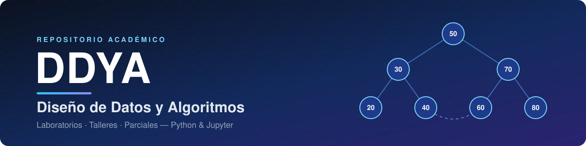

<div align="center">



<p></p>


**Talleres, laboratorios y parciales del curso Diseño de Datos y Algoritmos.**<br>
<sub>Del problema al código: requerimientos · diagramas · análisis de complejidad · implementación · pruebas</sub>

[**Entregas**](#estructura-del-repositorio) &nbsp;·&nbsp;
[**Temas**](#temas-y-estructuras-de-datos-cubiertas) &nbsp;·&nbsp;
[**Metodología**](#metodología-de-los-laboratorios) &nbsp;·&nbsp;
[**Cómo explorar**](#cómo-explorar-el-repositorio) &nbsp;·&nbsp;
[**Autores**](#autores)

</div>

---

## Sobre el curso

DDYA aborda el diseño de algoritmos y la selección de estructuras de datos adecuadas para resolver problemas reales, con énfasis en análisis de complejidad (Big-O), buenas prácticas de diseño de software y validación mediante pruebas.

## Estructura del repositorio

| Entrega | Tema | Notebook / archivo principal |
| --- | --- | --- |
| [Semana 1](./Semana%201) | Ejercicio diagnóstico (números, paridad, Fibonacci) | [`#Santiago Lugo ejercicio diagnostico.py`](<./Semana 1/#Santiago Lugo ejercicio diagnostico.py>) |
| [Semana 2](./Semana2) | Ordenamiento — Insertion Sort para organización de precios | [`Laboratorio_Semana_2_Extasys_code ..ipynb`](<./Semana2/Laboratorio_Semana_2_Extasys_code ..ipynb>) |
| [Semana 3](./Semana3) | Búsqueda y organización de productos (arreglos ordenados) | [`Lab_Semana3_ExtasysCode.ipynb`](./Semana3/Lab_Semana3_ExtasysCode.ipynb) |
| [Semana 4](./Semana4) | Programación dinámica — cambio de monedas (proyecto ODS) | [`Lab_Semana4_ExtasysCode.ipynb`](./Semana4/Lab_Semana4_ExtasysCode.ipynb) |
| [Laboratorio de estructuras lineales](<./Laboratorio de estructuras lineales>) | Sistema de atención de tienda con colas y pilas (FIFO/LIFO) | [`Laboratorio_de_estructuras_lineales.ipynb`](<./Laboratorio de estructuras lineales/Laboratorio_de_estructuras_lineales.ipynb>) |
| [dev-pr-dynamic](./dev-pr-dynamic) | Programación dinámica — crecimiento de suscriptores (memoización) | [`apps_suscriptores.ipynb`](./dev-pr-dynamic/apps_suscriptores.ipynb) |
| [Semana 8](./Semana-8) | Árboles binarios — BST y AVL para organización de códigos de productos | [`Arboles-binarios (Extasys code).ipynb`](<./Semana-8/Arboles-binarios (Extasys code).ipynb>) |
| [Semana 9](./Semana-9) | Grafos — recorridos BFS y DFS sobre una red de centros | [`Grafos(Estasys code).ipynb`](<./Semana-9/Grafos(Estasys code).ipynb>) |
| [Parcial — Red de transporte](./parcial-grafos-red-transporte) | Parcial práctico: modelado de una red de transporte urbano con grafos, BFS y DFS (con Alejandro Peña) | [`Parcial_Grafos_Red_Transporte_...ipynb`](<./parcial-grafos-red-transporte/Parcial_Grafos_Red_Transporte_Santiago_Lugo_Gomez_y_Alejandro_Peña_().ipynb>) |
| [Laboratorio TDA](<./Laboratorio TDA>) | Heap y cola de prioridad — gestión de tareas de un centro de cómputo con Max-Heap | [`Laboratorio-Heap y Cola de Prioridad.ipynb`](<./Laboratorio TDA/Laboratorio-Heap y Cola de Prioridad.ipynb>) |

## Temas y estructuras de datos cubiertas

- **Fundamentos:** condicionales, recursividad (Fibonacci).
- **Ordenamiento y búsqueda:** Insertion Sort, búsqueda sobre arreglos ordenados.
- **Estructuras lineales:** colas (FIFO) y pilas (LIFO).
- **Programación dinámica:** memoización, cambio de monedas, modelos de crecimiento recursivo.
- **Árboles:** árboles binarios de búsqueda (BST) y balanceo con AVL.
- **Heaps y colas de prioridad:** Max-Heap sobre arreglo, MAX-HEAPIFY y BUILD-MAX-HEAP.
- **Grafos:** representación de redes y recorridos BFS/DFS.

## Metodología de los laboratorios

Cada laboratorio sigue una estructura común, alineada con el proceso de diseño de software:

1. **Descripción del problema** — contexto y objetivo del ejercicio.
2. **Requerimientos** — funcionales y no funcionales.
3. **Historias de usuario**.
4. **Diagramas** — de flujo, de secuencia y de casos de uso.
5. **Análisis de complejidad** — notación Big-O de la solución propuesta.
6. **Código funcional** — implementación en Python.
7. **Pruebas** — de enunciado, propias y de desempeño.

## Tecnologías

- **Python 3** para la implementación de los algoritmos.
- **Jupyter Notebook** para documentar el diseño y las pruebas de cada laboratorio.

## Cómo explorar el repositorio

```bash
git clone https://github.com/SantiagoLugoGomez/DDYA.git
cd DDYA
jupyter notebook
```

Cada notebook puede abrirse y ejecutarse de forma independiente; no requieren dependencias externas más allá de la librería estándar de Python.

## Autores

**Santiago Lugo Gómez**

Colaboración en el parcial de grafos (red de transporte): **Alejandro Peña**.
